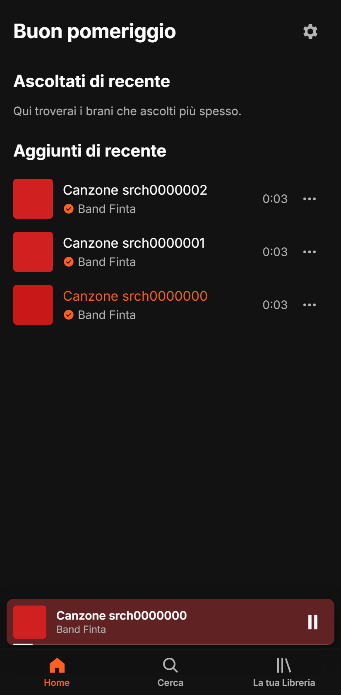
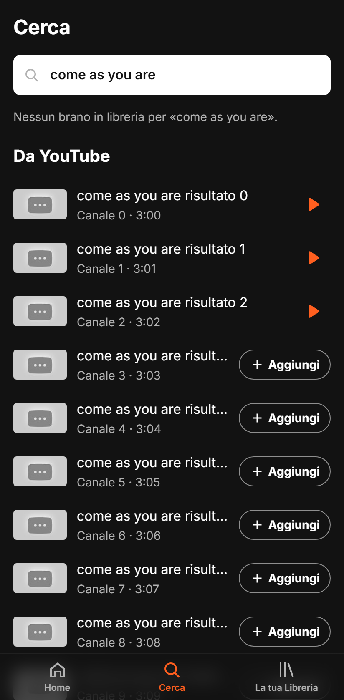
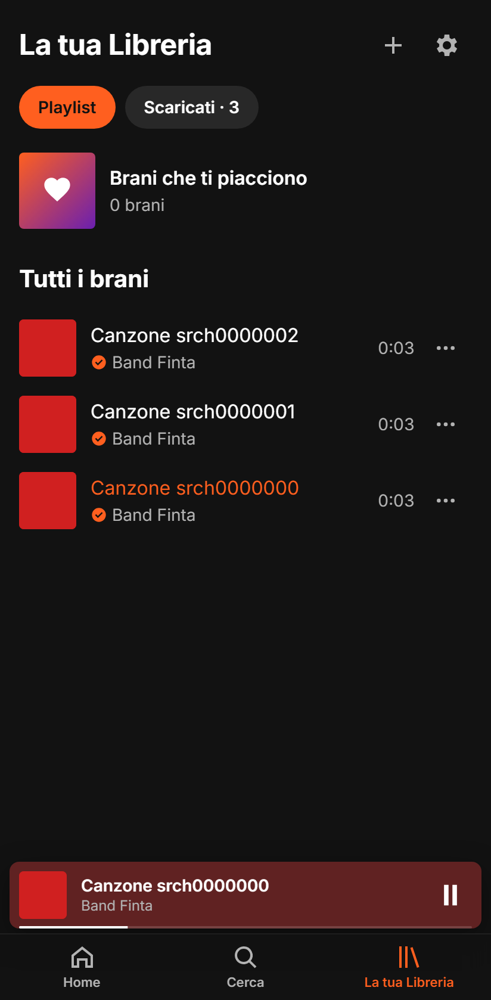
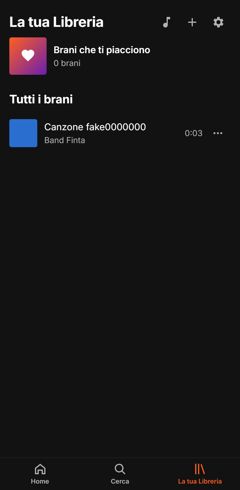
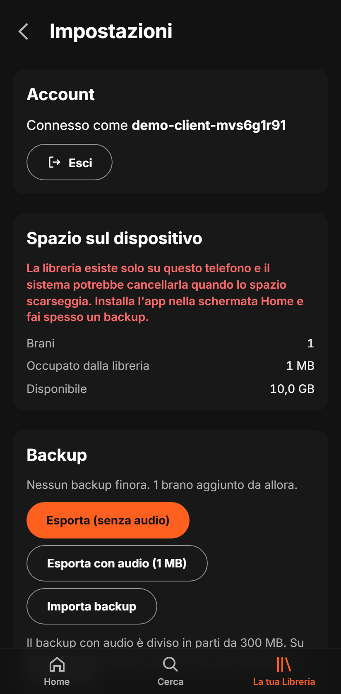

# Spookyfy

Player musicale personale: una **PWA** per iPhone e Android (audio in background, lockscreen, offline) che importa brani da YouTube. Due modi di installarla:

| | **Vercel** (modalità client) | **On-premise** |
|---|---|---|
| Dove sta la musica | sul telefono | sul tuo server |
| Server da gestire | nessuno (gateway serverless) | Raspberry Pi, mini-PC o server Linux |
| Streaming | no: si ascoltano i brani salvati sul telefono | sì, più download per l'offline |
| Importazione | YouTube dal gateway, file dal telefono, ponte verso un on-premise | YouTube con `yt-dlp` |
| Backup | file esportato dall'app | database + cartella media |

<table>
  <tr>
    <td></td>
    <td></td>
    <td></td>
  </tr>
  <tr>
    <td></td>
    <td></td>
    <td></td>
  </tr>
</table>

<sub>Screenshot con dati di prova, rigenerabili con `pnpm screenshots`.</sub>

## Come funziona

```
On-premise   telefono (PWA) ──Cloudflare Tunnel──▶ server: API + SQLite + yt-dlp + MP3
Vercel       telefono (PWA + libreria nel browser) ──▶ gateway: login, ricerca, proxy audio (nessun dato salvato)
```

1. **Cerca** → **Aggiungi**: il brano viene importato e si ascolta subito.
2. La PWA lo salva per l'offline (on-premise: con il tasto download; Vercel: sempre).
3. Per registrarsi serve un token di invito (default `spotifymerdacostosa2026`, **cambialo**); password di almeno 8 caratteri con lettere, cifre e un simbolo.

## Installazione su Vercel

1. Vercel → **Add New → Project** → importa il repository.
2. **Root Directory: `apps/gateway`** (Framework: *Other*), con *Include files outside the root directory* attivo.
3. **Storage → Marketplace → Upstash for Redis**, collegato al progetto.
4. **Settings → Environment Variables**:

   ```bash
   SESSION_SECRET=...        # genera con: openssl rand -base64 48
   REGISTRATION_TOKEN=...    # il tuo token di invito
   ```

5. **Deploy**, poi apri l'URL dal telefono → *Crea un account* con il token.

YouTube può bloccare gli IP di Vercel: in quel caso usa **Libreria → Importa da file** o il [ponte verso un on-premise](docs/bridge.md). Fai spesso **Impostazioni → Backup**: la libreria esiste solo sul telefono.

## Installazione on-premise

```bash
# Dipendenze (Debian, Ubuntu, Raspberry Pi OS 64 bit)
sudo apt install -y ffmpeg git curl
curl -fsSL https://deb.nodesource.com/setup_22.x | sudo -E bash - && sudo apt install -y nodejs
sudo corepack enable
sudo curl -L https://github.com/yt-dlp/yt-dlp/releases/latest/download/yt-dlp -o /usr/local/bin/yt-dlp
sudo chmod a+rx /usr/local/bin/yt-dlp

# Utente, cartelle e build
sudo useradd --system --home /var/lib/spookyfy --shell /usr/sbin/nologin spookyfy
sudo mkdir -p /var/lib/spookyfy/data /var/lib/spookyfy/media /etc/spookyfy
sudo chown -R spookyfy:spookyfy /var/lib/spookyfy
sudo git clone https://github.com/federicocunico/spookyfy.git /opt/spookyfy && cd /opt/spookyfy
sudo pnpm install --frozen-lockfile && sudo pnpm build

# Configurazione: imposta PUBLIC_ORIGIN e REGISTRATION_TOKEN
sudo cp apps/server/.env.example /etc/spookyfy/spookyfy.env
sudo nano /etc/spookyfy/spookyfy.env

# Servizio (più l'aggiornamento automatico di yt-dlp)
sudo cp deploy/*.service deploy/*.timer /etc/systemd/system/
sudo systemctl daemon-reload
sudo systemctl enable --now spookyfy yt-dlp-update.timer

# Esposizione su Internet senza aprire porte
cloudflared tunnel login
cloudflared tunnel create spookyfy
cloudflared tunnel route dns spookyfy spookyfy.example.com
sudo mkdir -p /etc/cloudflared
sudo cp deploy/cloudflared/config.yml /etc/cloudflared/   # sostituisci UUID e dominio
sudo cp ~/.cloudflared/<UUID>.json /etc/cloudflared/
sudo cloudflared service install
```

Aggiornamento:

```bash
cd /opt/spookyfy && sudo git pull && sudo pnpm install --frozen-lockfile && sudo pnpm build
sudo systemctl restart spookyfy
```

## Sul telefono

- **iPhone**: Safari → *Condividi* → *Aggiungi a schermata Home*.
- **Android**: Chrome → *Installa app*.

Apri Spookyfy sempre dall'icona: solo così funzionano lockscreen, audio in background e storage persistente.

## Sviluppo

```bash
corepack enable && pnpm install
pnpm dev                               # on-premise: server :8787 + Vite :5173
pnpm --filter @spookyfy/gateway dev    # modalità client: :4174 (KV in memoria, YouTube finto)
pnpm test && pnpm test:e2e             # unit/integrazione e Playwright
pnpm lint && pnpm typecheck
```

## Documentazione

[Guida completa](docs/guida.md) (variabili, dimensionamento, backup, limiti di Vercel) · [Account](docs/auth.md) · [Ponte on-premise](docs/bridge.md) · Verifiche su [iPhone](docs/verification-ios.md) e [Android](docs/verification-android.md)

> `yt-dlp` e il gateway sono pensati per uso personale: il rispetto dei termini delle piattaforme è responsabilità di chi installa Spookyfy.
